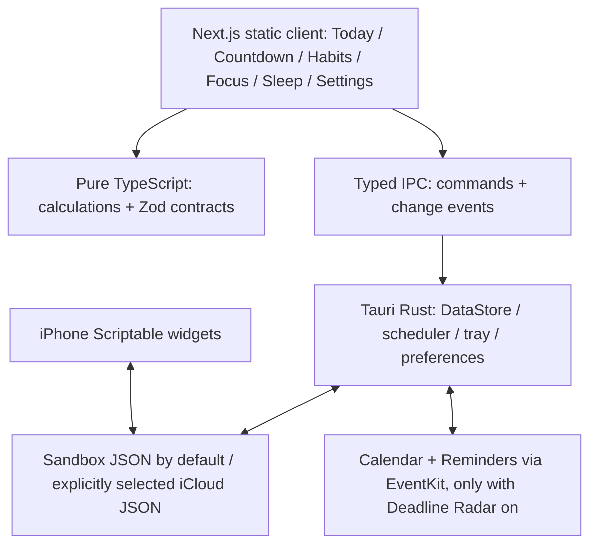

# Daybar

**Your day, at a glance.** Daybar brings a countdown, daily habits, a focus timer and a sleep-shift plan into one quiet window and menu bar (macOS) or tray (Windows). Built from everyday iPhone Scriptable widgets, it keeps the original dark, monospace, tiny-square visual language while using shared JSON in iCloud Drive or Google Drive rather than a server, account or database. No telemetry.

https://github.com/user-attachments/assets/874b7938-1924-4767-9223-2d31b9761d53

*48-second ad (click to play, with sound): habits, focus, countdown, Deadline Radar, Day and Night, and iPhone sync. Rendered from the browser build's demo data; the installed app starts blank. How it's made: [media notes](docs/screenshots/README.md).*

> **Preview:** Apple Silicon, macOS 12.3+, and Windows 10/11 (64-bit) from 0.4.0. Ad-hoc signed and not notarized on the Mac; not code-signed on Windows. Real iPhone/iCloud acceptance is not claimed. See the [release, verification and safe-switch guide](docs/RELEASE.md).

## Download the Mac app

Get the newest version from the [latest release](https://github.com/xolah88457/daybar/releases/latest):

- `Daybar_<version>_aarch64.dmg`: mount it and copy Daybar to Applications.
- `Daybar_<version>_aarch64.app.zip`: extract the complete app bundle.
- `SHA256SUMS.txt`: checksums for the files above.

These downloads need no Node/Rust installation. macOS will not recognise the developer on first open; see [opening the app](docs/RELEASE.md#opening-the-app-on-a-mac) for the steps.

## Download for Windows

From 0.4.0 Daybar also runs on Windows 10 and 11 (64-bit). Download `Daybar_<version>_x64-setup.exe` from the [latest release](https://github.com/xolah88457/daybar/releases/latest) and run it; it installs for your account only and needs no administrator rights. The installer is not code-signed, so SmartScreen says "Windows protected your PC": check the file against `SHA256SUMS.txt`, then choose **More info → Run anyway** ([details](docs/RELEASE.md#opening-the-app-on-windows)).

The Windows app has the same pages, features and look as the Mac app, built around Google instead of Apple ([DECISIONS 018](docs/DECISIONS.md)):

| On the Mac | On Windows |
| --- | --- |
| iCloud Drive folder shared with the iPhone | A Google Drive for desktop folder (**Settings → On this PC → Use a Google Drive folder**), shared with your other computers |
| Deadline Radar reads macOS Calendar and Reminders, plus Google | Deadline Radar reads Google Calendar and Google Tasks ([sign in](#google-calendar-and-tasks)) |
| Menu-bar label, Dock icon | Tray icon with the label in its tooltip (double-click to open); **Hide taskbar button** |
| Keychain | Windows Credential Manager, for the Google sign-in |
| Run a Shortcut on focus start and end | Not available: Windows has no Shortcuts app, so the option is hidden |
| ⌘K, ⌘1–9 | Ctrl+K, Ctrl+1–9 |

The iPhone Scriptable widgets read iCloud Drive, so they stay a Mac companion.

**Updates:** from v0.2.0, **Settings → Check for updates** looks for a newer release on GitHub, installs it after verifying its updater signature, and offers a restart. It runs only when you click; Daybar never checks in the background. v0.1.0 has no updater, so install v0.2.0 manually once. How releases and the signing key work: [release guide](docs/RELEASE.md#publishing-a-release-and-in-app-updates).

## Everyday controls

- Press the number keys to switch screens; the numbers follow the sidebar, so they shift when you turn modules or features on or off. Typing, composition and open dialogs are protected.
- Use the header **Day/Night** button, or **Settings → On this Mac** (**On this PC** on Windows) **→ Appearance → Auto** to follow macOS or Windows. Set macOS itself to Auto for scheduled day/night changes; Daybar requests no location.
- Choose **Settings → On this Mac → Menu-bar label** (**Tray label** on Windows), then **Save Mac preferences**: Auto, focus minutes/hours/blocks, active timer, bedtime, next task, countdown days only or, with Deadline Radar on, next deadline. Focus totals are today's credited work; explicit modes stay selected even during a timer.
- Landscape Today is compact; portrait stacks the cards. Small windows and long forms scroll rather than hide controls.

## Optional features

**Settings → Features** groups everything into five sections that stay closed until you open one; each shows how many of its switches are on, and a feature's own settings sit behind its **Options** toggle. The choices are stored only on this computer (`preferences.json`); the settings file shared with the phone is never changed. Turning a page off hides its screen, Today card, menu-bar label and alerts, and keeps its data.

Almost everything starts **on**. Only the three that interrupt you often or change how sessions run start off: hourly chime, movement nudges and auto-cycle. Features marked *built in* have no switch: they do nothing until you use them, or come with the feature they belong to. Updating from 0.3.0 switches on the features that now start on, once; after that your choices stay as you set them.

| Section | Feature | Starts | What it does |
| --- | --- | --- | --- |
| Pages | Countdown, Habits, Focus, Sleep | On | The four main pages. |
| | Insights | On | Focus, habits and sleep this week vs last week, built from data you already have. |
| Deadline Radar | Deadline Radar | On | Calendar events and reminders with due dates (on Windows: Google Calendar and Google Tasks), colored by urgency like the phone widget. Own screen, Today card, optional "next deadline" menu-bar label and a daily "Due tomorrow" alert. Asks for Calendars/Reminders access the first time you open the Deadline Radar page, or when you press **Grant access**. |
| | Room before next event | Built in | "Room for ~N focus blocks before Design review at 12:15", from your next timed event today. Shown once Calendar access is granted. |
| Reminders | Check-ins | On | "Plan your day" in the morning; "N tasks left" in the evening (skipped when you're done). |
| | Streak saver | On | One alert before bed if today's habits would break your streak. |
| | Hourly chime | Off | A notification on the hour, outside quiet hours. |
| | Movement nudges | Off | "Stand up and stretch" every N minutes in your active hours, skipped during focus. |
| Focus sessions | Away detection | On | If the computer sits idle during focus, asks "Still focusing?" and offers to stop the timer. |
| | Auto-cycle | Off | When a focus session runs to the end, the break starts by itself; a long break every Nth session. |
| | Run a Shortcut | Built in | Runs a macOS Shortcut you name when focus starts and ends, e.g. to turn on Do Not Disturb. Leave the names blank to run nothing. Mac only. |
| Tools | Export history | Built in | Saves focus, habit and sleep history as CSV or JSON to Downloads. Never changes your data. |
| | Command palette | Built in | ⌘K (Ctrl+K on Windows) to jump to a screen, start or stop focus, tick off a task or log wake/bed. |
| | Extra countdowns | Built in | More countdowns on Today once you add one. Desktop only; the phone keeps the main countdown. |

Alerts only fire while Daybar is running, like every other Daybar notification. None of these features use the network, except Google Calendar and Tasks once you connect them (below).

### Google Calendar and Tasks

On the Mac, Deadline Radar reads everything in macOS Calendar and Reminders, which already includes iCloud and any Google account added under System Settings → Internet Accounts. On Windows, and on the Mac if you prefer, connect Google directly in **Settings → Deadline Radar → Options → Google Calendar and Tasks** (on Windows the Deadline Radar page offers it too). Daybar uses your own Google Cloud OAuth client, so nothing is shared with anyone else:

1. In [console.cloud.google.com](https://console.cloud.google.com), create a project and enable the **Google Calendar API** and the **Google Tasks API**.
2. Under **Google Auth Platform**, set up the consent screen as *External* and add your Google address as a test user.
3. Under **Clients**, create an OAuth client of type **Desktop app**, and copy its client ID and client secret.
4. Paste both into Daybar and press **Connect Google**. Your browser opens Google's consent page; approve read-only calendar and task access and return to Daybar.

Google's calendars then appear in the Calendars list (next to iCloud ones on a Mac) and your task lists under Task lists. Events and tasks with a due date show on the radar, its Today card, alerts and the tray or menu-bar label; a task is an all-day item on its due date, and completed tasks are left out. An event that is in both Google and macOS Calendar shows once. The sign-in is kept in the macOS Keychain or Windows Credential Manager and never written to the data folder or the phone. **Disconnect** revokes it. If you connected in 0.3.4, which asked for calendars only, press **Connect Google** once more to add your tasks.

### Spaces, subtasks and setup

- **Spaces** keep work, personal life and anything else apart: each has its own tasks, history, countdowns and focus time. Create one on the **Overview** page, which shows today's progress, streak and focus for every space side by side; each space then has its own page in the sidebar. The iPhone widgets keep showing your main space.
- **Subtasks:** press **+** next to any task to add steps. They stay collapsed behind a count such as **2/3**; the task ticks itself when every step is done.
- **Setup:** a new install opens a short guided setup. Run it again, or remove the sample data, from **Settings → Start fresh**; the browser demo's banner also has **Remove demo data**.

## From Scriptable widgets to a desktop app

The starting point was five separate Scriptable home-screen tools: Days Left, Daily Log, Focus Timer, Time Blindness + Sleep, and Deadline Radar. All five are on Mac: Deadline Radar is an optional feature that reads Calendar and Reminders on the Mac itself (the phone widget keeps reading the phone's own calendars). Today combines time until bed, focus controls, today's checklist, focus blocks and the countdown grid. Original scripts remain untouched in [`legacy/`](legacy/).

## iPhone Scriptable widgets

The five standalone scripts are in [`scriptable/`](scriptable/README.md): [Days Left](scriptable/Days%20Left.js), [Daily Log](scriptable/Daily%20Log.js), [Focus Timer](scriptable/Focus%20Timer.js), [Time Blindness + Sleep](scriptable/Time%20Blindness%20%2B%20Sleep.js), and [Deadline Radar](scriptable/Deadline%20Radar.js). Open each file on GitHub and use **Raw** to download or copy its complete source into Scriptable.

Install **Scriptable** from the iOS App Store by searching its name. For a shared phone/Mac setup, enable iCloud Drive on both devices with the same Apple ID and enable Scriptable's iCloud Drive access. Back up existing phone-local and iCloud Scriptable data before setup. On Mac, explicitly connect Daybar to the real Scriptable **Documents** folder only after reviewing the data and making backups; save valid shared settings with the intended task names before first use on phone, and confirm the Mac's read-only `habits.logId` matches the existing log filename. The Mac app is standalone without the phone; the phone companion requires Scriptable and these scripts. Keep shared files in iCloud Drive's `Scriptable` folder and avoid simultaneous edits. Full setup, widget parameters, data mapping and recovery guidance: [Scriptable setup guide](scriptable/README.md).

The desktop app includes editable settings, habit streaks, history-preserving task renames, focus-to-habit credit and “room for ~N blocks before bed.” Notifications are scheduled by Rust **only while Daybar is running**; this is not a background service, and OS notification delivery remains unverified.

## Architecture in a minute



Next.js is statically exported into Tauri's WKWebView: no SSR, server actions or runtime server. The frontend never accesses the filesystem directly. Rust owns validation, atomic file writes and OS integration; `packages/core` owns deterministic calculations. Browser development uses an in-memory IPC preview, not live shared files. Details: [architecture](docs/ARCHITECTURE.md), [calculation conventions](docs/CORE_API.md), [data formats](docs/DATA_FORMATS.md), [decisions](docs/DECISIONS.md).

### Shared files, not magic sync

Daybar itself works without an iPhone; Scriptable is an optional companion for users who want shared files.

The phone and Mac share `daily-log-<LOG_ID>.json`, `focus-timer.json`, `sleep-data.json` and `daybar-settings.json`. Each mutation re-reads disk, applies one operation and validates. The Mac replaces files via a same-directory temporary file and atomic rename. Scriptable cannot atomically replace an existing file: it checks for intervening edits, moves the old file to a retained recovery backup, then installs the temporary file. A crash between those moves requires manual recovery; see the [phone guide](scriptable/README.md). Focus credit uses a session-start-keyed ledger so repeat settlement is a no-op; legacy daily totals remain a baseline.

**Limits:** atomic rename is not a cross-device transaction, and iCloud supplies no lock shared with the Mac. Re-reading narrows the race window but cannot guarantee that simultaneous phone/Mac edits never overwrite one another. Avoid editing the same data on both devices at once and keep backups. Conflict copies are surfaced for explicit merge/discard, never silently deleted. Full list: [safety limits](docs/ARCHITECTURE.md#safety-limits).

## Run locally — sandbox first

On Windows, install [Tauri's Windows prerequisites](https://v2.tauri.app/start/prerequisites/) (Microsoft C++ Build Tools and WebView2, which Windows 11 already has), Node 22, pnpm 10.12.3 and Rust, then run the same commands from Git Bash or PowerShell; build the installer with `pnpm tauri build --no-sign --bundles nsis`.

On the Mac, Daybar requires macOS 12.3 or later (the WKWebView HTML-dialog helper requires 12.3; native confirmation behavior was exercised on the test Mac), Xcode Command Line Tools (`xcode-select --install` if absent), **Node 22**, **pnpm 10.12.3**, and stable Rust with Cargo. Install Rust using [rustup](https://rustup.rs/) and consult [Tauri's macOS prerequisites](https://v2.tauri.app/start/prerequisites/). Commands below run from the repository root.

```sh
corepack enable
corepack prepare pnpm@10.12.3 --activate
pnpm install --frozen-lockfile
pnpm seed
pnpm tauri dev
```

`pnpm seed` creates `.dev-data/` from synthetic fixtures without replacing existing files. Development must default to the sandbox; do not select a personal folder to test features. Browser-only preview: `pnpm dev` at `http://127.0.0.1:3000` (memory-only data; no native tray or notifications). No real iCloud path is needed for development or CI.

### Checks and builds

```sh
pnpm lint
pnpm typecheck
pnpm test:tz                 # core, desktop UI and phone tests in Toronto and London
pnpm test:rust               # cargo test for apps/desktop/src-tauri/Cargo.toml
pnpm build                   # static export: apps/desktop/out/
pnpm tauri build --no-sign --bundles app,dmg
```

`--no-sign` is for local builds without the updater key (otherwise the build errors "A public key has been found, but no private key"); release builds in CI omit it so the updater archive gets signed.

The app and DMG are produced under `apps/desktop/src-tauri/target/release/bundle/macos/` and `bundle/dmg/` respectively (unless Cargo's target directory is overridden). Tauri runs the static build before packaging. Release builds are **ad-hoc signed, not notarized** (`--no-sign` builds are unsigned); see [opening the app](docs/RELEASE.md#opening-the-app-on-a-mac).

[CI](.github/workflows/ci.yml) uses a macOS runner and a Windows runner, Node 22, pnpm 10.12.3 and stable Rust; it runs frozen dependency installation, lint, types, timezone tests, phone Node tests (required, never silently skipped), Rust tests and static export (the Windows runner repeats the Rust tests and static export). A `vX.Y.Z` tag additionally checks that the tag matches the app version, packages an ad-hoc signed, non-notarized `.app` and `.dmg`, an unsigned Windows installer, their signed updater files and one `latest.json` for both, and creates a **draft** GitHub Release for you to review and publish by hand. Only that last job holds a write token, and the only secrets are the two updater signing-key secrets used by the build step; real iCloud access is never configured.

## Opt in to real data — only after verification

Follow the complete [release and safe-switch guide](docs/RELEASE.md); do not switch valuable data based on this README alone. In short: back up the phone's existing local data and the Scriptable **Documents** folder first; install the updated scripts per the [phone guide](scriptable/README.md); then, in Daybar Settings → **On this Mac**, press **Use my iPhone’s Scriptable folder (iCloud Drive)** (or type the folder path), tick both confirmations and save. A new install starts blank, with one placeholder habit and no history, until you connect. Do not repoint dev/test commands at it, and merely installing or building Daybar never probes it. Daybar writes its own timestamped backup as part of the first real write, so keep your own dated backup **before** opting in, and stop on any backup or validation error. Malformed or unknown files never become an empty replacement. In Finder, choose **Keep Downloaded** for the shared folder where available, and let iCloud finish syncing before switching devices.

On Windows the same rules apply to a Google Drive folder: install Google Drive for desktop, press **Settings → On this PC → Use a Google Drive folder** (it creates `My Drive\Daybar`), tick both confirmations and save. Make the folder available offline in Google Drive, and let it finish syncing before you open Daybar on another computer. Two computers editing at once can produce a conflict copy such as `daybar-settings (1).json`; Daybar shows a **Sync conflict** notice for it, like an iCloud conflict on the Mac.

Sandbox acceptance on fictional data covered the tray, external-file refresh, focus stop/expiry, the global shortcut, close-hide/reopen, confirmation dialogs, Day/Night/Auto, bare 1–6 navigation and all eight menu-bar modes. Actual iCloud materialization, full native conflict resolution and cross-device convergence remain unverified; the exact scope is in [what was verified](docs/RELEASE.md#what-was-verified).

## Stack & repository map

- **Tauri 2 / Rust:** native window, tray, scheduling, file safety; serde, notify and Tauri plugins.
- **Next.js App Router / React / strict TypeScript:** static client interface, no runtime server.
- **Zod / Vitest / Cargo tests:** contracts and deterministic calculations; pnpm workspaces.
- **Scriptable / iCloud Drive:** standalone iPhone widgets, shared backward-compatible JSON. Google Drive for desktop plays the same part on Windows.

| Path | Responsibility |
| --- | --- |
| `apps/desktop/` | Next UI, typed IPC, `src-tauri/` backend |
| `packages/core/` | Pure logic, schemas, fixtures and tests |
| `scriptable/` | Updated phone scripts, isolated tests and install/recovery notes |
| `legacy/` | Original five scripts, preserved unchanged |
| `scripts/seed-sandbox.mjs` | Non-destructive synthetic sandbox seed |
| `docs/` | Architecture, calculation conventions, data formats, decisions, release/verification, screenshot notes |
| `.github/workflows/` | macOS and Windows checks; tag builds create a draft release with updater files |

## Roadmap

- Owner acceptance: real phone/iCloud setup, pending native/OS checks and a tag-built release; see [what is not established](docs/RELEASE.md#not-established).
- Bundle the tested core for Scriptable `importModule()` reuse (stretch).

## License

[MIT](LICENSE). Copyright belongs to Daybar contributors; no personal identity is assumed.
