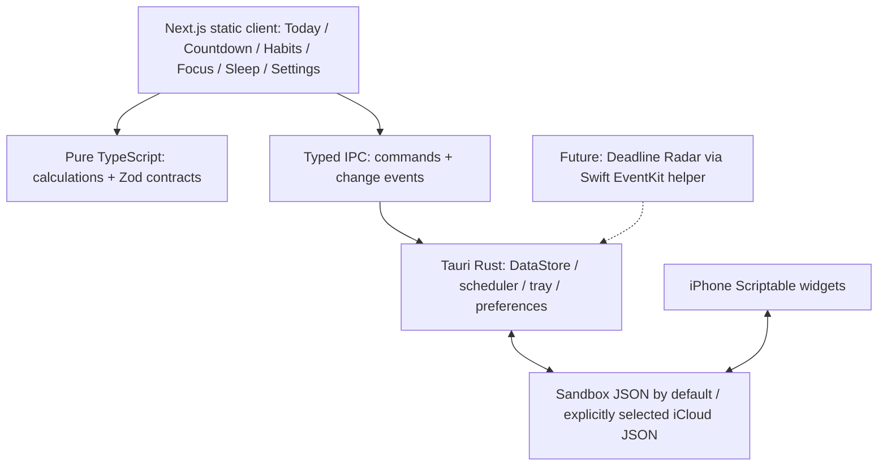

# Daybar

**Your day, at a glance.** Daybar brings a countdown, daily habits, a focus timer and a sleep-shift plan into one quiet macOS window and menu bar. Built from everyday iPhone Scriptable widgets, it keeps the original dark, monospace, tiny-square visual language while using shared JSON in iCloud Drive rather than a server, account or database. No telemetry.

> **Work in progress:** feature integration and acceptance verification are pending. This README describes the v1 experience and safety contract, not a claim that every feature has shipped. See the [verification ledger](docs/VERIFICATION.md) and [documentation check report](docs/DOCS_REPORT.md).

[Today dashboard hero — `docs/screenshots/today.png`](docs/screenshots/today.png)

*Screenshot placeholder: not yet captured. The linked image will be added after a sandbox-only UI check; the link is intentionally unresolved today.*

**Menu bar timer GIF:** not yet captured. Planned asset: `docs/screenshots/menu-bar.gif`.

## From Scriptable widgets to a desktop app

The starting point was four small home-screen tools: Days Left, Daily Log, Focus Timer, and Time Blindness + Sleep. Each answered one question; on a Mac those questions belong together. Today is the combined view: time until bed, focus controls, today's checklist, focus blocks and the countdown grid. Dedicated pages leave room for history, planning and settings.

**iPhone screenshot placeholder:** personal widget screenshot to be supplied by the owner; no image captured or included yet. Original scripts remain untouched in [`legacy/`](legacy/).

The intended desktop experience adds editable settings, habit streaks, history-preserving task renames, focus-to-habit credit and “room for ~N blocks before bed.” Notifications are scheduled by Rust **only while Daybar is running**; this is not a background service. See [capture instructions](docs/screenshots/README.md) before adding portfolio media.

## Architecture in a minute



Next.js is statically exported into Tauri's WKWebView: no SSR, server actions or runtime server. The frontend never accesses the filesystem directly. Rust owns validation, atomic file writes and OS integration; `packages/core` owns deterministic calculations. Browser development uses an in-memory IPC preview, not live shared files. Details: [architecture](docs/ARCHITECTURE.md), [data formats](docs/DATA_FORMATS.md), [decisions](docs/DECISIONS.md).

### Shared files, not magic sync

The phone and Mac share `daily-log-<LOG_ID>.json`, `focus-timer.json`, `sleep-data.json` and `daybar-settings.json`. Each mutation must re-read disk, apply one operation, validate, then replace the file via a same-directory temporary file and rename. Focus credit uses a session-start-keyed ledger so repeat settlement is a no-op; legacy daily totals remain a baseline.

**Concurrency limitation:** atomic rename is not a cross-device transaction. Scriptable's `FileManager.iCloud()` synchronizes files; it does not supply a distributed transaction or a lock shared with the Mac. Re-reading narrows the race window but cannot guarantee that simultaneous phone/Mac edits never overwrite one another, even with idempotent focus credit. Conflict copies must be surfaced for explicit merge/discard, never silently deleted. Avoid editing the same data simultaneously; retain backups. These safety behaviours still require the checks in the ledger.

## Run locally — sandbox first

Requires macOS (app target: macOS 12+), Xcode Command Line Tools (`xcode-select --install` if absent), **Node 22**, **pnpm 10.12.3**, and stable Rust with Cargo. Install Rust using [rustup](https://rustup.rs/) and consult [Tauri's macOS prerequisites](https://v2.tauri.app/start/prerequisites/). Commands below run from the repository root.

```sh
corepack enable
corepack prepare pnpm@10.12.3 --activate
pnpm install --frozen-lockfile
pnpm seed
pnpm tauri dev
```

`pnpm seed` creates `.dev-data/` from synthetic fixtures without replacing existing files. Development must default to the sandbox; do not select a personal folder to test features. Browser-only preview: `pnpm dev` at `http://127.0.0.1:3000` (memory-only data; no native tray or notifications). No real iCloud path is needed for development or CI.

### Checks and builds

```sh
pnpm lint
pnpm typecheck
pnpm test:tz                 # Vitest in America/Toronto and Europe/London
node --test scriptable/tests/*.test.mjs  # phone integration must be present
pnpm test:rust               # cargo test for apps/desktop/src-tauri/Cargo.toml
pnpm build                   # static export: apps/desktop/out/
pnpm tauri build --no-sign --bundles app,dmg
```

The app and DMG are produced under `apps/desktop/src-tauri/target/release/bundle/macos/` and `bundle/dmg/` respectively (unless Cargo's target directory is overridden). Tauri runs the static build before packaging. Builds are **unsigned and not notarized**. After mounting a trusted DMG and copying Daybar to Applications, **right-click Daybar → Open**, then confirm Open if macOS offers it. Gatekeeper behaviour varies by macOS/security policy; do not disable Gatekeeper or strip quarantine globally. If blocked, build from source or use the system's app-specific approval flow only after reviewing provenance.

[CI](.github/workflows/ci.yml) uses a macOS runner, Node 22, pnpm 10.12.3 and stable Rust; it runs frozen dependency installation, lint, types, timezone tests, phone Node tests, Rust tests and static export. Phone tests are required, not silently skipped if missing. A `v*` tag additionally packages an unsigned `.app` and `.dmg` and uploads them as **Actions artifacts**, not a signed GitHub Release. Download them from that tag's Actions run; the app is zipped to preserve bundle metadata and artifact retention is 14 days. The workflow uses a read-only repository token; no signing credentials, secrets or real iCloud access are configured. Writing this workflow does **not** mean GitHub CI has run or passed.

## Opt in to real data — only after verification

1. Complete the safety checks in [VERIFICATION.md](docs/VERIFICATION.md) in a disposable sandbox. Keep a separate backup of the phone's existing local data before migration.
2. Follow the [updated phone script installation guide](scriptable/README.md). Installation notes arrive with the phone scripts; until the linked guide is available, keep working phone scripts unchanged. Review the migration steps before replacing them.
3. In Daybar Settings, explicitly choose the Scriptable iCloud Drive **Documents** folder and consent to using real data. Do not repoint dev/test commands at it. Merely installing or building Daybar must not probe it.
4. Before the first real write, Daybar must copy **every managed file it will touch** to a timestamped backup folder. Confirm the backup exists and is readable before editing. Malformed/unknown files must produce a visible error, never an empty replacement.
5. In Finder, choose **Keep Downloaded** for the shared folder where available. Evicted `.icloud` placeholders can delay reads; failed downloads should remain visible errors. Allow iCloud to finish syncing before switching devices.

The real-folder flow, backups, placeholder handling and conflict resolution are acceptance requirements, not verified promises in this documentation. Do not use valuable data until they pass.

## Stack & repository map

- **Tauri 2 / Rust:** native window, tray, scheduling, file safety; serde, notify and Tauri plugins.
- **Next.js App Router / React / strict TypeScript:** static client interface, no runtime server.
- **Zod / Vitest / Cargo tests:** contracts and deterministic calculations; pnpm workspaces.
- **Scriptable / iCloud Drive:** standalone iPhone widgets, shared backward-compatible JSON.

| Path | Responsibility |
| --- | --- |
| `apps/desktop/` | Next UI, typed IPC, `src-tauri/` backend |
| `packages/core/` | Pure logic, schemas, fixtures and tests |
| `scriptable/` | Updated phone scripts and install notes (integration pending) |
| `legacy/` | Original five scripts, preserved unchanged |
| `scripts/seed-sandbox.mjs` | Non-destructive synthetic sandbox seed |
| `docs/` | Architecture, formats, decisions, verification, screenshots |
| `.github/workflows/` | macOS checks and unsigned tag artifacts |

## Roadmap

- Finish and verify v1 parity, live sandbox sync, native integration and safe phone migration.
- **Deadline Radar:** intentionally out of v1; navigation/module seam for a small **Swift EventKit helper** to read calendar events and reminders with explicit permissions.
- Insights relating sleep consistency, focus and habits (stretch).
- Bundle the tested core for Scriptable `importModule()` reuse (stretch).

## License

[MIT](LICENSE). Copyright belongs to Daybar contributors; no personal identity is assumed.
