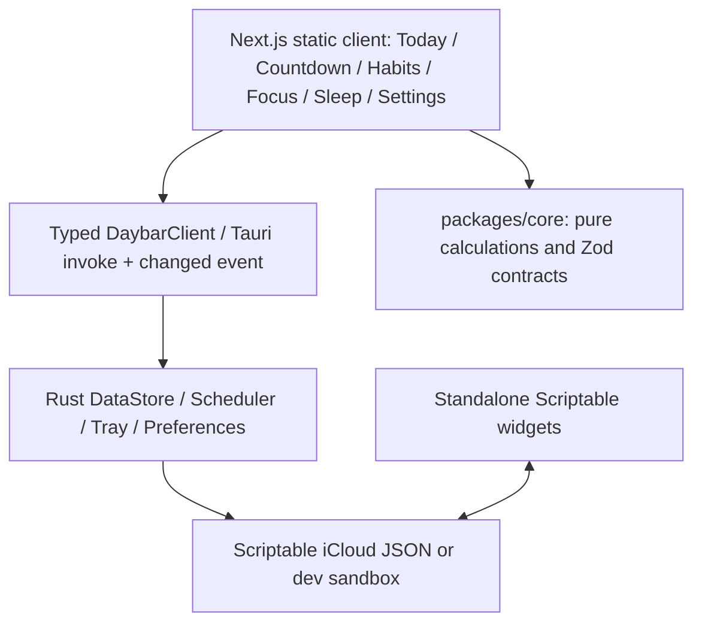

# Daybar architecture

No server, accounts, telemetry or runtime network access. Static Next export runs in a Tauri 2 WKWebView. Rust alone reads and writes files; the browser preview uses memory, never a filesystem. Pure TypeScript receives explicit `now` and settings so its tests can reproduce midnight and DST.

## Boundaries
- `packages/core/src/contracts/index.ts`: authoritative field names, settings defaults, schemas, IPC operation union; JSON Schemas alongside. Rust mirrors these in `src-tauri/src/contracts.rs` and validates on both read and before write.
- `apps/desktop/src/lib/ipc.ts`: only frontend `invoke` / event boundary. `daybar://changed` invalidates the snapshot. State is loaded once and refreshed after events and mutations.
- DataStore: sandbox default, selective real-folder opt-in, backup before first real mutation, same-directory atomic rename, validation, watcher, placeholder downloads, visible conflicts. Every mutation re-reads current disk data; no cached snapshot is ever written.
- Focus: legacy `days` become immutable `baseline` on upgrade; `sessions[start]` is a unique credited-session ledger. Daily totals are baseline plus sessions. Duplicate settlement is a no-op. Explicit task-set operations are idempotent (not blind toggles).
- Scheduler computes future focus and sleep deadlines, fires immediate desktop notifications from Rust while alive, and rebuilds after data changes. Tray and global shortcut use the same mutation path as UI.
- Preferences are app-local: folder, consent flag, launch at login, Dock visibility, shortcut. Shared settings contain only widget configuration.

## Safety limits
File-level rename is atomic, but iCloud Drive provides no cross-device compare-and-swap. Re-read/apply/write narrows rather than eliminates simultaneous-device races. Merge conflict copies explicitly; never silently discard. Cross-file task-history changes must preserve old entries if a later write fails. Symlinks/path traversal and a developer-supplied path must not bypass sandbox policy.

## Extension seam
Deadline Radar remains a disabled navigation slot. Future implementation can introduce a Swift EventKit helper behind typed Rust commands without adding filesystem access to the frontend. Insights and a bundled phone core are stretch only.

## Toolchain sources
Checked 2026-11-15: https://v2.tauri.app/start/frontend/nextjs/ prescribes `output: 'export'`, `frontendDist: '../out'`, `devUrl` and unoptimized images (guide says its Next example is accurate as of 14.2.3). Registry selected Next 16.4.6, React 19.3.1, Tauri CLI 2.12.4; lockfiles pin actual versions. https://v2.tauri.app/plugin/notification/ does not provide reliable desktop future scheduling, so Rust owns timing. Build uses Next's webpack path for predictable monorepo static export.
